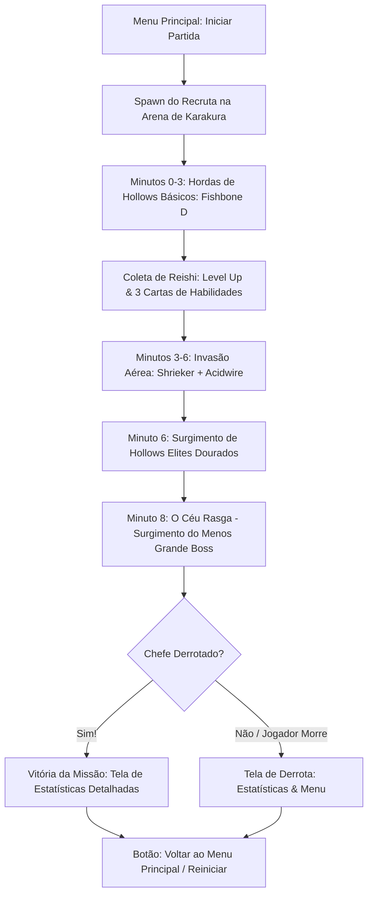

# 04 - Arquitetura da Versão 1: Loop de Combate, Hordas e Telas de Fim de Jogo

Este documento especifica as regras de negócio, a mecânica de combate, a progressão de ondas e a interface completa da **Versão 1** do jogo.

---

## 1. O Loop da Partida na Versão 1



---

## 2. O Protagonista da V1: Recruta Shinigami

* **Status Iniciais:**
  * Vida Máxima: $100\text{ HP}$
  * Velocidade de Movimento: $5.2\text{ unidades/s}$
  * Raio de Coleta de Reishi (Ímã natural): $3.5\text{ unidades}$
  * Redução de Recarga: $0\%$
* **Ataque Padrão Inicial:**
  * **Corte de Asauchi (Katana Básica):** Golpe semicircular frontal automático a cada $1.1\text{ s}$, causando $25\text{ de dano}$ a todos os inimigos no arco frontal de $120^\circ$.

---

## 3. Sistema de Level Up e Habilidades (3 Escolhas)

Ao acumular Reishi (pontos de experiência deixados pelos Hollows derrotados), o jogo pausa suavemente e exibe um modal central com **3 cartas aleatórias** entre ataques e aprimoramentos passivos:

### 3.1. Habilidades Ativas (Armas Espirituais)
1. **Corte de Asauchi (Katana):**
   * *Níveis 1-5:* Aumenta área, dano (+20%) e reduz tempo de recarga.
2. **Hadō #4: Byakurai (Raio Branco):**
   * Dispara um feixe elétrico reto perfurante no Hollow mais próximo, atravessando vários inimigos em linha.
3. **Hadō #31: Shakkahō (Canhão de Fogo Vermelho):**
   * Lança uma esfera de fogo de Reiatsu que explode ao impactar, causando dano em área (AoE).
4. **Bakudō #9: Geki (Paralisia Espiritual):**
   * Cria uma onda de choque vermelha ao redor do recruta que empurra e paralisa os inimigos por $1.5\text{ s}$.

### 3.2. Aprimoramentos Passivos (Talentos do Shinigami)
1. **Treinamento de Shunpo:** +10% de velocidade de movimento por nível.
2. **Densidade de Reiatsu:** +15% de dano global para todos os ataques.
3. **Controle Espiritual:** +25% de raio de atração de Reishi no mapa.
4. **Armadura Shihakusho:** +10% de redução de dano sofrido e regeneração de $1\text{ HP/s}$.

---

## 4. O Chefe da Versão 1: Menos Grande (Gillian)

* **Momento de Invocação:** Ocorre aos **8 minutos** de partida (ou ao atingir uma meta de abates na arena fechada).
* **Entrada Cinemática:**
  * O céu da arena escurece com um efeito de fenda espacial (*Garganta*).
  * A câmera faz um leve zoom-in dramático de 2 segundos.
  * O Menos Grande surge com sua máscara branca pontiaguda e contorno vermelho carmesim.
* **Padrão de Ataque do Chefe:**
  1. **Passo Esmagador:** Dano pesado de contato e repulsão se o jogador se aproximar demais.
  2. **Disparo de Cero:** O Menos carrega uma luz vermelha na boca por $2.0\text{ s}$ com uma faixa de telegrafia vermelha no chão. Em seguida, dispara um raio massivo que consome 60% da vida do jogador se não for evitado com movimento lateral.
* **Fim da Partida:**
  * Ao zerar os pontos de vida do Menos Grande, todos os Hollows remanescentes se desintegram em partículas de Reishi.
  * A música de vitória da Soul Society toca e a **Tela de Estatísticas** surge automaticamente.

---

## 5. Especificação da Tela de Fim de Jogo (Relatório Final)

A tela de conclusão de missão é um dos pontos mais importantes do projeto. Ela deve exibir com clareza todo o histórico da tentativa:

```
+--------------------------------------------------------------------------+
|                     MISSÃO CUMPRIDA: INVASÃO CONTIDA                     |
|                   Subdivisão de Karakura - 13ª Divisão                   |
+--------------------------------------------------------------------------+
|  Tempo de Sobrevivência: 08:42          Nível Alcançado: Nv. 18          |
|  Dano Total Infligido: 142.850          DPS Médio: 274.5                 |
|  Reishi Total Coletado: 1.420           Almas Purificadas (Kills): 684   |
+--------------------------------------------------------------------------+
| [ Habilidades Utilizadas ]                                               |
|  * Asauchi Slash       Nv. 5 (Dano: 68.200 - 47.7%)                      |
|  * Hadō #4 Byakurai    Nv. 4 (Dano: 45.100 - 31.6%)                      |
|  * Hadō #31 Shakkahō   Nv. 3 (Dano: 29.550 - 20.7%)                      |
|  * Shunpo Master       Nv. 2                                             |
|  * Densidade Reiatsu   Nv. 3                                             |
+--------------------------------------------------------------------------+
| [ Censo de Hollows Derrotados ]                                          |
|  * Fishbone D:         412 abatidos                                      |
|  * Shrieker:           184 abatidos                                      |
|  * Acidwire:            82 abatidos                                      |
|  * Hollows Elites:       5 abatidos                                      |
|  * Menos Grande:         1 DERROTADO (CHEFE)                             |
+--------------------------------------------------------------------------+
| [ Itens Coletados ]                                                      |
|  * Frascos da 4ª Divisão (Cura): 6                                       |
|  * Gikon / Soul Candy (Ímã): 4                                           |
+--------------------------------------------------------------------------+
|          [ REINICIAR MISSÃO ]            [ VOLTAR AO MENU ]              |
+--------------------------------------------------------------------------+
```

### 5.1. Ações Disponíveis
* **Botão "Reiniciar Missão":** Reseta os buffers da arena, reinicia o cronômetro e inicia imediatamente uma nova run como Recruta.
* **Botão "Voltar ao Menu":** Retorna à tela inicial de seleção de personagem e configurações.
