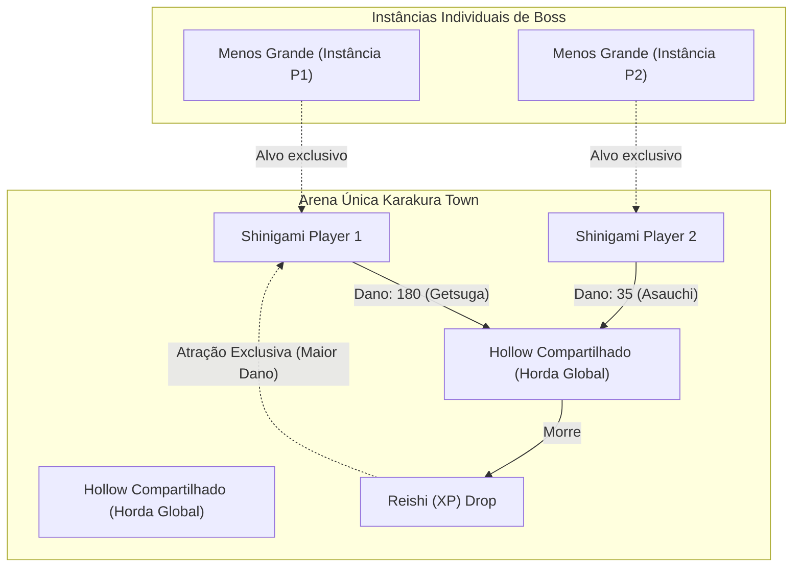

# Diretriz 11: Arquitetura Multiplayer V1, Mecânica de Pulo e Level Up Dinâmico

## 1. Visão Geral da Arquitetura Multiplayer na V1

Na primeira entrega (Versão 1), o modelo multiplayer adota uma arquitetura híbrida focada em **fricção competitiva no mapa comum** e **conclusão de mérito individual no Chefe**:



---

## 2. Componentes da Arquitetura Multiplayer

### 2.1 Mapa Comum e Inicial
- Todos os jogadores conectados ingressam na mesma arena circular de **Karakura Town** ($170\text{ m}$ de diâmetro).
- Cada jogador possui um identificador único de sessão (`state.localPlayerId = 'shinigami_xxxx'`).
- A movimentação, saltos e rotações são sincronizados no espaço 3D global.

### 2.2 Hordas Compartilhadas e Disputa de Reishi (DPS Winner)
- Os Hollows normais (`Fishbone D`, `Shrieker`, `Acidwire`) circulam na arena pública e podem ser alvejados por qualquer jogador.
- Cada Hollow mantém uma tabela de contribuição de dano em tempo de execução:
  ```javascript
  en.damageContributions = {
    "shinigami_a1b2": 180, // Jogador 1 (Getsuga)
    "shinigami_c3d4": 45   // Jogador 2 (Byakurai)
  };
  ```
- **Drop e Coleta de Reishi:**
  Quando o Hollow é eliminado (`en.hp <= 0`):
  1. O sistema calcula o jogador com o maior dano acumulado naquele monstro:
     $$\text{winnerId} = \arg\max_{pid} (\text{damageContributions}[pid])$$
  2. A partícula de Reishi é gerada marcada com `ownerPlayerId: winnerId`.
  3. No loop de atração magnética (`updateReishi`), apenas o jogador dono da partícula atrai e absorve o XP. Outros jogadores não podem "roubar" o Reishi conquistado.

### 2.3 Boss Final Instanciado Individualmente (Menos Grande)
- Ao atingir a marca de 8 minutos ou abater a cota pessoal de Hollows, o jogador engilha o portal da *Garganta*.
- O **Menos Grande (Gillian)** surge como uma **instância local/individual** vinculada exclusivamente àquele jogador (`en.targetPlayerId = state.localPlayerId`).
- Isso garante que a vitória final (ou derrota) dependa exclusivamente da habilidade do próprio jogador, sem que outros jogadores interfiram ou facilitem o combate do chefe.

---

## 3. Mecânica de Pulo Vertical (Tecla Espaço)

Para enriquecer a esquiva e mobilidade, foi implementada a física vertical completa:
- **Acionamento:** Tecla `Espaço` (`Space`).
- **Constantes Físicas:**
  - Velocidade inicial de salto: $v_y = 8.5\text{ m/s}$.
  - Aceleração da gravidade: $g = 24.0\text{ m/s}^2$.
- **Sombra Dinâmica Projetada:**
  - A sombra permanece ancorada no chão ($y = 0.02$).
  - Conforme o Shinigami sobe, a sombra atenua seu tamanho e opacidade proporcionalmente à altura:
    $$\text{scale} = \max(0.35, 1.0 - \frac{y}{2.5} \times 0.5)$$
- **Evasão Vertical de Hollows:**
  Se o jogador estiver no ar ($y \ge 0.9\text{ m}$), ele salta por cima do raio de colisão físico dos Hollows terrestres, evitando o dano de contato.

---

## 4. Sistema de Level Up Dinâmico em Tempo Real (Sem Congelamento)

### 4.1 Filosofia Anti-Pausa
Ao evoluir de nível:
- **O jogo NÃO é pausado** (`state.paused = false`). Os Hollows continuam avançando, os ataques continuam disparando e o jogador continua se movendo.
- Um banner flutuante compacto surge na parte inferior do HUD (`#levelup-banner`), exibindo até 3 opções de habilidades.

### 4.2 Atalhos Numéricos e Seleção
- O jogador pode pressionar **`[1]`**, **`[2]`** ou **`[3]`** no teclado para escolher instantaneamente a carta desejada sem soltar as teclas de movimento (`WASD`).
- Também é possível clicar diretamente com o mouse sobre os cards.

### 4.3 Mecânica de Sobrescrita (Replacement Build)
- Diferente de roguelikes convencionais onde dezenas de armas se acumulam infinitamente:
  - Ao escolher uma nova arma especial (ex: `Byakurai` ou `Shakkahō`), **a arma especial anterior é desativada** (`level = 0`) e a nova é ativada (`level = 1`).
  - O corte básico de katana (**Asauchi**) permanece como arma secundária constante.
  - Ao escolher uma passiva, ela substitui a especialização passiva ativa anterior.
- **Pular Escolha (`[0] / [P]` ou botão Pular):**
  Se o jogador já estiver satisfeito com seu poder atual (ex: Getsuga Tenshō nível máximo) e não quiser perder seu poder, ele pressiona `0` ou `P` para fechar o banner e manter sua build intacta.
