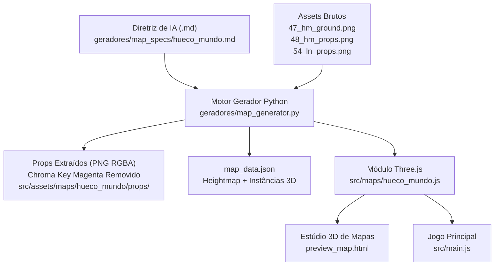

# Diretriz 12: Gerador de Mapas Orientado por IA e Bioma Hueco Mundo (V1)

## 1. Visão Geral e Mudança Estratégica da V1

Por direcionamento de design e lore canônico de Bleach, o cenário inicial da **Versão 1** foi atualizado:
- **Cenário Anterior:** Arena Urbana Fechada de Karakura Town.
- **Cenário Oficial V1:** **Deserto Infinito do Hueco Mundo** — a dimensão desértica e estéril habitada pelos Hollows e Arrancars sob noite eterna e luar perpétuo.

Para permitir que a criação de cenários seja escalável e extensível a futuros biomas (Karakura Town, Soul Society/Seireitei, Dangai, Interior de Las Noches e Palácios), foi desenvolvido um **Motor de Geração de Mapas Comandado por IA via Diretrizes em Markdown** (`geradores/map_generator.py`).

---

## 2. Arquitetura do Gerador de Mapas (`geradores/map_generator.py`)

O gerador opera desacoplando a **intenção de design da IA** (expressa em Markdown com frontmatter YAML) da **matemática de renderização 3D**:



### 2.1 Especificação Declarativa em Markdown (`geradores/map_specs/hueco_mundo.md`)
O arquivo `.md` define todos os parâmetros interpretáveis pela IA:
- **`world`**: Dimensões ($220\text{m} \times 220\text{m}$), raio da arena ($88\text{m}$) e resolução da malha ($64 \times 64$).
- **`heightmap`**:
  - `seed`: Semente determinística para reprodutibilidade.
  - `dune_frequency` e `dune_amplitude`: Frequência e elevação das dunas centrais ($\pm 1.8\text{m}$).
  - `mountain_start_radius` e `mountain_max_height`: Início da subida dos penhascos periféricos ($8\text{m}$ a $18\text{m}$) que delimitam a arena natural de combate.
- **`atmosphere`**:
  - Cor do céu noturno (`#070b14`), névoa espiritual profunda (`#0a0f1d`), posição e tamanho da lua do Hueco Mundo.
- **`props`**:
  - Lista de elementos decorativos (árvores de quartzo, obeliscos, rochedos, portais e colunas de Las Noches), suas dimensões em metros no mundo e raios de colisão física.

---

## 3. Matemática do Relevo 3D e Física do Terreno

### 3.1 Função de Elevação do Terreno (`get_terrain_height`)
Para cada coordenada $(x, z)$, a altura $y$ é calculada combinando ondas de dunas com penhascos circulares:
$$y(x, z) = \text{Dunas}(x, z) \cdot \text{AtenuaçãoCentro}(r) + \text{Penhascos}(r)$$

Onde:
$$\text{Dunas}(x, z) = \sin(0.035x) \cos(0.03z + 1.2) \times 1.8 + \sin((x+z) \cdot 0.015) \times 1.0$$
$$\text{Penhascos}(r) = \left( \frac{r - 70.0}{30.0} \right)^{2.2} \times 14.0 \quad (\text{para } r > 70\text{m})$$

### 3.2 Interpolação Bilinear em Tempo de Execução (`getTerrainHeight(x, z)`)
O jogo consulta a altura exata do solo para qualquer posição arbitrária do Shinigami e dos monstros:
```javascript
export function getTerrainHeight(x, z) {
  const gx = (x + HALF_W) / STEP_X;
  const gz = (z + HALF_Z) / STEP_Z;
  // Interpolação bilinear entre h00, h10, h01 e h11
  const top = h00 * (1 - fx) + h10 * fx;
  const bottom = h01 * (1 - fx) + h11 * fx;
  return top * (1 - fz) + bottom * fz;
}
```

---

## 4. Pipeline de Processamento de Sprites e Props

Os assets brutos de Bleach (`48_hm_props.png` e `54_ln_props.png`) utilizam fundo magenta clássico (`#e71fe7` / `#ff00ff`).
O gerador executa:
1. **Detecção e Remoção Suave de Chroma Key:**
   Calcula a distância do magenta: $\text{score} = \frac{R + B}{2} - G$.
2. **De-spill de Bordas:**
   Remove o vazamento magenta em pixels semitransparentes nos contornos dos galhos de quartzo e colunas de Las Noches.
3. **Rotulagem de Componentes Conexos:**
   Recorta individualmente cada prop sem perdas e salva em `src/assets/maps/hueco_mundo/props/prop_*.png`.
4. **Dispersão Determinística (Scatter Rules):**
   Instancia 99 props pelo mapa respeitando distâncias mínimas para não obstruir o centro do combate.

---

## 5. Ferramenta de Visualização 3D (`preview_map.html`)
Criado o **360° Map Studio**:
- Acesso direto via `/preview_map.html` ou pelo botão no topo direito do HUD do jogo.
- Permite órbita 360° livre, zoom, alternância de malha wireframe (estilo Minecraft), visualização de colisores físicos em vermelho e inspeção de luz.
