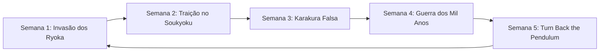

# PRD: NPCs do Seireitei & Crônicas Semanais de Bleach

| Metadado | Detalhe |
| :--- | :--- |
| **Feature** | NPCs do Seireitei e Crônicas Históricas Semanais |
| **Status** | Especificação Técnica (Pronto para Revisão) |
| **Autores** | Time de Engenharia & Game Design Bleach Idle |
| **Alvo** | Milestone 1 (o repositório não usa tags de versão) |

---

## 1. Visão Geral e Objetivos do Produto

### 1.1. Contexto
No estado atual, o mapa da **Soul Society (Seireitei)** funciona primordialmente como ponto de passagem e área de caçada (nível 14+ com Hollows no Rukongai e bonecos de treino). A rica ambientação dos 13 Esquadrões de Proteção (Gotei 13) e os eventos canônicos da obra de Tite Kubo ainda não são vivenciados diretamente pelos jogadores de forma narrativa.

### 1.2. Proposta de Valor
Introduzir **NPCs interativos icônicos no Seireitei** (capitães, tenentes e cronistas) que apresentam semanalmente **Crônicas Históricas de Bleach**. A cada semana real, o servidor rotaciona um grande evento do cânone da obra, permitindo que os jogadores conheçam os detalhes da história, interajam com personagens lendários e concluam missões temáticas semanais com recompensas valiosas.

### 1.3. Objetivos de Engajamento
1. **Retenção Semanal (D7 / D30):** Estabelecer um ciclo de renovação semanal que motive jogadores ativos e inativos a retornar a cada segunda-feira para descobrir o novo acontecimento histórico.
2. **Imersão na Lore:** Fornecer aos fãs de Bleach uma recapitulação interativa das grandes sagas da obra em formato pixel art/MMORPG.
3. **Recompensas Relevantes:** Fornecer uma fonte consistente e não pay-to-win de Cristais da conta, kan, caixas do Kisuke e títulos históricos cosméticos.

---

## 2. Personas e Casos de Uso

| Persona | Perfil | Como usufrui da feature |
| :--- | :--- | :--- |
| **O Fã de Bleach (Lore Hunter)** | Conhece a obra e gosta da fidelidade aos arcos do anime/mangá. | Visita o Seireitei a cada nova semana para ler os diálogos detalhados dos capitães e colecionar títulos temáticos de cada saga. |
| **O Jogador Idle / Eficiente** | Foca em otimização de recursos e progressão rápida. | Interage rapidamente com o NPC principal na segunda-feira, pega a missão semanal da crônica e a completa automaticamente durante sua rotina de Auto Hunt. |
| **O Iniciante (Nível 14-30)** | Chegou recentemente na Soul Society e busca direção. | Encontra nos NPCs guias narrativos e incentivos extras de XP e kan para acelerar sua progressão no midgame. |

---

## 3. O Ciclo de Crônicas Semanais (Rotação Determinística)

O servidor opera em um calendário perpétuo de **5 grandes crônicas históricas**, rotacionando a cada 7 dias (virando à meia-noite de domingo para segunda-feira no horário de Brasília / UTC-3):

### Detalhamento das 5 Crônicas:

#### 1. Semana 1: A Invasão dos Ryoka (Saga Soul Society)
- **Tema:** Intrusos cruzaram a barreira de Shakonmaku! O Seireitei entra em estado de sítio contra o grupo de Ichigo, Uryū, Chad e Orihime.
- **NPC Central:** *Sentinela do Portão / Oficial da 11ª Divisão*.
- **Narrativa:** Descreve a quebra do céu pelos fogos de artifício da família Shiba, o duelo na ponte e a corrida contra o tempo antes da execução de Rukia.
- **Missão Semanal:** "Patrulha de Contenção" — derrotar 50 Hollows na Soul Society e coletar 3 Fragmentos de Reiatsu.
- **Recompensa:** 500 kan, 15 Cristais da conta, 1 Caixa do Kisuke e Título temporário *"Guardião do Shakonmaku"*.

#### 2. Semana 2: O Julgamento do Soukyoku & A Traição de Aizen
- **Tema:** A revelação mais chocante do Seireitei: o assassinato forjado do Capitão Aizen, o massacre na Central 46 e a extração do Hōgyoku.
- **NPC Central:** *Cronista da 1ª Divisão / Capitão Tōshirō Hitsugaya*.
- **Narrativa:** Relata a intervenção na lâmina de Soukyoku, o confronto de Ichigo e Byakuya, e a ascensão dos três traidores (Aizen, Gin e Tōsen) aos céus através da luz do Negación.
- **Missão Semanal:** "Investigação da Central 46" — derrotar o chefe Metastacia no Rukongai e entregar o Relatório Lacrado.
- **Recompensa:** 800 kan, 20 Cristais da conta, 1 Pergaminho de Treino (+50% XP por 1h) e Título *"Testemunha do Soukyoku"*.

#### 3. Semana 3: Batalha de Karakura Falsa (Gotei 13 vs Espadas)
- **Tema:** O mundo real é salvo pelo mecanismo de transposição de Kisuke Urahara; os capitães erguem 4 pilares e enfrentam o exército de Espadas de Aizen.
- **NPC Central:** *Capitão Shunsui Kyōraku*.
- **Narrativa:** O duelo descontraído porém mortal de Shunsui contra Coyote Starrk, o gelo mortal de Hitsugaya contra Harribel e o poder do envelhecimento de Barragan.
- **Missão Semanal:** "Defesa dos Pilares" — derrotar 30 monstros em Karakura Falsa ou no Hueco Mundo.
- **Recompensa:** 1.000 kan, 25 Cristais da conta, 1 Incenso da Sorte (+30% loot por 1h) e Título *"Defensor dos Pilares"*.

#### 4. Semana 4: A Guerra Sangrenta dos Mil Anos (Invasão Quincy)
- **Tema:** As sombras engolem a Soul Society. O império invisível do Wandenreich surge sob os comandos de Yhwach e rouba as Bankais dos capitães.
- **NPC Central:** *Oficial Veterano do Seireitei*.
- **Narrativa:** A invasão relâmpago, o sacrifício de Chōjirō Sasakibe, a fúria abrasadora de Yamamoto Genryūsai e a queda temporária do Gotei 13.
- **Missão Semanal:** "Resistência das Sombras" — derrotar 25 Soldados do Wandenreich ou monstros de nível 50+.
- **Recompensa:** 1.200 kan, 30 Cristais da conta, 2 Caixas do Kisuke e Título *"Cinzas da Primeira Divisão"*.

#### 5. Semana 5: Turn Back the Pendulum (110 Anos no Passado)
- **Tema:** O passado secreto do Gotei 13: Kisuke Urahara como recém-nomeado Capitão da 12ª Divisão, Yoruichi capitã da 2ª, e a noite chuvosa da Hollowficação dos futuros Visored.
- **NPC Central:** *Arquivista da Academia Shinigami*.
- **Narrativa:** A criação do Instituto de Pesquisa e Desenvolvimento Espiritual (SRDI), o desaparecimento dos soldados no Rukongai e o julgamento que exilou Urahara e Tessai ao mundo humano.
- **Missão Semanal:** "Arquivos Secretos de Reishi" — realizar 1 sessão de treino no Boneco de Treino e entregar 5 Pedras de Reishi.
- **Recompensa:** 600 kan, 20 Cristais da conta, 1 Amuleto da Alma e Título *"Arquivista do Passado"*.

---

## 4. NPCs Alocados no Seireitei (Soul Society)

No mapa `soul.tmj`, a área segura (PZ) central ao redor do portal Senkaimon receberá 3 NPCs temáticos posicionados para não bloquear o tráfego dos jogadores:

| NPC ID | Nome Visível | Título do NPC | Sprite Base | Posição no Mapa | Função |
| :--- | :--- | :--- | :--- | :--- | :--- |
| `npc_cronista` | **Maki** | *Cronista do Gotei 13* | `rukia__haori` | `x: 21, y: 14` | NPC principal: apresenta a crônica semanal ativa, conta os detalhes históricos e entrega a missão da semana. |
| `npc_shunsui` | **Shunsui Kyōraku** | *Capitão da 8ª Divisão* | `byakuya` (com tint/chapéu) | `x: 26, y: 13` | Comentários descontraídos sobre o estado do Seireitei, diálogos reflexivos sobre batalhas passadas e dicas de combate. |
| `npc_sentinela` | **Sentinela do Seireitei** | *13ª Divisão* | `renji__haori` | `x: 23, y: 16` | Informações sobre a segurança do portal Senkaimon, alertas de invasão e ambientação militar. |

---

## 5. Fluxo do Jogador e Interface (UX)

1. **Aproximação:** O jogador viaja até a Soul Society (via Senkaimon ou portal). Na praça segura, vê os NPCs destacados com seus nomes, títulos e um ícone flutuante `📜`.
2. **Interação:**
   - O jogador clica no NPC ou aproxima-se e pressiona a tecla de interação (`E` ou botão de toque no mobile).
   - Se estiver a mais de `INTERACT_RANGE` (2 tiles), o personagem se desloca automaticamente até o NPC.
3. **Janela de Diálogo Imersiva:**
   - Abre uma janela modal estilizada com a moldura clássica de pixel art do jogo (`theme.css`).
   - Cabeçalho: Nome e Título do NPC acompanhado de seu retrato visual.
   - Corpo do Diálogo:
     - Badge da Crônica da Semana (ex.: `[CRÔNICA SEMANAL: A INVASÃO DOS RYOKA]`).
     - Texto narrativo dividido em parágrafos legíveis.
   - Botões de Ação:
     - `[Continuar / Ouvir Mais]`: Avança pelos diálogos da lore.
     - `[Aceitar Missão da Semana]` / `[Entregar Missão]`: Gerencia a tarefa temática.
     - `[Fechar]` (ou tecla `ESC`).

---

## 6. Requisitos Funcionais (RF)

- **RF01 (Identificação de Semana):** O servidor deve computar a crônica semanal ativa deterministicamente através de `Date.now()`, alinhado à virada de domingo para segunda-feira (00:00 BRT).
- **RF02 (Interação Autoritativa):** O servidor deve validar a distância do jogador em relação ao NPC (`chebyshev <= 2`) antes de emitir o diálogo.
- **RF03 (Diálogos Contextuais):** O NPC principal deve alterar suas falas e a missão oferecida dinamicamente dependendo da crônica semanal ativa.
- **RF04 (Progresso Persistente da Missão):** A conclusão da missão semanal de cada crônica deve ser registrada no perfil do personagem no banco SQLite, garantindo que a recompensa só possa ser coletada uma vez por ciclo semanal.
- **RF05 (Entrega de Recompensas):** Ao concluir a missão, o servidor deve creditar automaticamente os kan, Cristais da conta, itens e título no inventário/conta do jogador e registrar o evento no log.
- **RF06 (Compatibilidade Mobile):** O modal de diálogo deve ser responsivo para telas sensíveis ao toque com áreas de toque mínimas de 44x44 px e botão claro de fechar no canto superior direito.

---

## 7. Requisitos Não Funcionais (RNF)

- **RNF01 (Performance de Rede):** O envio do diálogo não deve trafegar dados desnecessários; textos estáticos devem residir em `shared/` e o servidor deve enviar apenas o identificador da crônica, estado da missão e IDs de diálogo.
- **RNF02 (Compatibilidade com Mapas do Tiled):** A adição de NPCs não pode quebrar mapas existentes nem sobrescrever o arquivo `soul.tmj` com ferramentas externas sem validação.
- **RNF03 (Segurança e Zero-Trust):** Toda validação de aceitação e entrega de missão deve ser processada exclusivamente no `WorldRoom.ts`, impedindo injeção de missões já concluídas.
- **RNF04 (Testabilidade Automatizada):** A feature deve incluir testes unitários para a rotação de semanas em `shared/test/` e testes E2E com Vitest em `server/test/` validando o fluxo completo de interação e entrega de recompensa.

---

## 8. Pontos em aberto, conferidos contra o código (31/10/2026)

| # | O que o documento assume | O que o código mostra | Decisão necessária |
| :-- | :--- | :--- | :--- |
| 1 | Itens "Fragmentos de Reiatsu" (semana 1) e "Relatório Lacrado" (semana 2) | Não existem em `shared/src/items.ts`. Existem `pedra_reishi` (Pedra de Reishi) e `fragmento` (Fragmento de Máscara) | Criar os itens ou reaproveitar os existentes |
| 2 | "Monstros de nível 50+" (semana 4) | `MonsterDef` não tem nível | Listar ids (`soldado_wandenreich`, `sternritter`...) ou usar o mapa `wandenreich` |
| 3 | "Título temporário" | Os cosméticos são permanentes (`wallets.owned`) | Criar a expiração ou trocar por título permanente |
| 4 | Recompensa em Cristais uma vez por ciclo | A trava é por personagem e a carteira é por conta. Na diária, 2 personagens da mesma conta renderam +5 cada (saldo 5, depois 10), e o limite é 5 personagens por conta | **Decidido (D-001, 31/10/2026): por personagem**, como a diária. O balanceamento conta com até 5 personagens por conta (a diária paga 35 cristais por semana por personagem; a crônica, de 15 a 30) |
| 5 | NPC central diferente em cada semana (Sentinela do Portão, Cronista, Hitsugaya, Oficial Veterano, Arquivista) | A seção 4 define só 3 NPCs (Maki, Shunsui, Sentinela) | O Maki cobre todas as semanas, ou criar os NPCs que faltam |
| 6 | NPCs em (21,14), (26,13) e (23,16) no `soul.tmj` | Conferido: os três estão na zona segura (x de 14 a 33, y de 10 a 17), em tiles livres | Nenhuma |
| 7 | Sprites `rukia__haori`, `byakuya`, `renji__haori` | Existem em `client/public/assets/sprites/` | Nenhuma |
| 8 | Recompensas: Caixa do Kisuke, Pergaminho de Treino, Incenso da Sorte, Amuleto da Alma | Existem (`caixa_kisuke`, `pergaminho_xp`, `incenso`, `amuleto_alma`) | Nenhuma |
