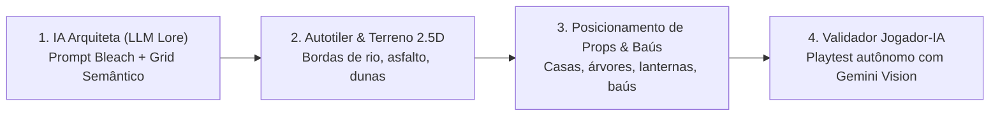

# ADR — Arquitetura da IA Geradora de Cenários 2.5D & Esteira de Playtest

- **Status:** Proposto / Aprovado para Implementação
- **Data:** 05/11/2026
- **Contexto:** Necessidade de produzir mundos muito maiores e detalhados (Karakura ampliada, Rukongai, Seireitei interno, Hueco Mundo com Floresta dos Menos, Palácio Real) com estética 2.5D (estilo Pokémon Omega Ruby), garantindo consistência com o cânone de Bleach e integridade técnica (colisões, rotas transitáveis, baús e spawns).

---

## 1. O Pipeline da IA Geradora de Mapas (4 Estágios)

Em vez de gerar uma imagem estática que o jogo não sabe como colidir ou navegar, a esteira divide a criação em 4 camadas complementares:



### Estágio 1: IA Arquiteta (Blueprint Semântico via LLM)
- Um script (`art/maps/generators/ai_blueprint.py`) alimenta um modelo LLM (Gemini) com as diretrizes do bioma e regras canônicas de Bleach:
  - Exemplo: *"Gere uma matriz 80x80 representando o Distrito 1 de Rukongai (Junrinan). Defina o curso d'água principal do norte ao sul, um vilarejo com 6 casas ao leste, um santuário ao norte com um baú escondido atrás de um bambuzal, e uma estrada de terra batida que conduz ao Portão Oeste do Seireitei (Hakuryūmon)."*
- A IA responde com um JSON estruturado contendo:
  - `regions`: zonas de terreno (estrada, rio, grama, praça, dunas).
  - `landmarks`: coordenadas dos edifícios principais.
  - `chests`: posições secretas de baús de loot.
  - `spawns`: áreas de monstros e patrulhas.

### Estágio 2: Autotiler & Construção de Malha 2.5D
- Um compilador em Python/TS processa o JSON do blueprint e aplica algoritmos de **Wang Tiles / Bitmask Autotiling**:
  - **Margens de Rios:** Transição suave entre terra/asfalto e lâmina d'água, com curvas côncavas e convexas.
  - **Elevações:** Muros de contenção e escadas que transmitem desnível de terreno característico de Pokémon 2.5D.
- Produz o arquivo de terreno base (`.png`) contínuo e a camada de tiles de colisão correspondente (`.tmj`).

### Estágio 3: Posicionamento de Props com Y-Sorting e Iluminação
- Props são posicionados seguindo regras de densidade:
  - Casas, postes de luz, árvores de cerejeira/zelkova, ruínas e baús.
  - O pé do prop define a caixa de colisão rígida (`solid = true`); a copa da árvore ou telhado da casa possui ordenação em Y (`depthSort`), permitindo que o personagem passe suavemente por trás.
  - Baús recebem `interactKind = "chest"` com rota transitável garantida em pelo menos um lado adjacente.

### Estágio 4: Validação Autônoma com o Jogador-IA (`test/`)
- Conforme descrito em `test/README.md`, o ambiente dispõe do **Jogador-IA** (Gemini Vision + Playwright).
- O agente `explorador` entra no novo mapa recém-gerado:
  1. Caminha por todos os quadrantes do mapa via A* e cliques.
  2. Verifica visualmente se há falhas estéticas (buracos de textura, props flutuando).
  3. Testa se todos os baús e portais de transição são alcançáveis.
  4. Emite um relatório de aprovação antes do mapa ser mergeado.

---

## 2. Geração Procedural da Zanpakutō e Bankai

Para a evolução do personagem ao nível 30 (Shikai) e 100 (Bankai):

```typescript
// Estrutura gerada na criação ou no despertar
export interface ZanpakutoSpirit {
  name: string;             // ex: "Kageboshi", "Raikōken", "Hyōga"
  element: ElementType;     // "fire" | "ice" | "lightning" | "shadow" | "wind" | "kido"
  callPhrase: string;       // ex: "Desperte", "Queime até as cinzas", "Corte os céus"
  bankaiName: string;       // ex: "Guren Raikōken", "Kageboshi Mugenjin"
  bankaiFormSprite: string; // Sprite variante ou aura customizada
  supremeSkill: SkillDef;   // Técnica de dano em área com efeitos visuais temáticos
}
```

- A geração ocorre no servidor (`server/src/zanpakuto.ts`) com base em um algoritmo determinístico que combina afixos espirituais poéticos em japonês com base no ID da conta/personagem (ou seleção por sorteio místico diante do Tenshintai).
- A Shikai e a Bankai são persistidas no `SaveData` do personagem em `db.sqlite`.

---

## 3. Consequências e Vantagens

- **Escalabilidade Infinita:** Novos distritos de Rukongai e zonas de Karakura podem ser gerados em minutos, em vez de semanas de desenho manual tile por tile.
- **Identidade e Retenção Única:** Nenhum jogador terá exatamente a mesma Bankai ou mesma progressão militar.
- **Alinhamento com a Base:** Usa exatamente os motores que o jogo já domina (`worldScenes.ts`, Colyseus `WorldRoom`, `build_regions.py` e o testador `Jogador-IA`).
