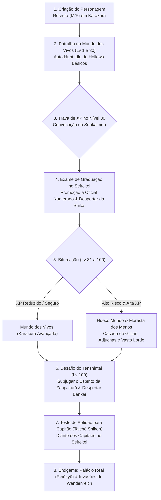

# PRD — A Jornada do Herói: Da Academia ao Capitão & O Mundo Expandido

- **Status:** Proposto / Especificação Ativa
- **Data:** 05/11/2026
- **Autor:** Waldir Junior & Antigravity (DeepMind)
- **Tema:** Progressão Canônica de Patentes, Geração Procedural de Zanpakutō/Bankai e Expansão Territorial 2.5D (Estilo Pokémon ORAS)

---

## 1. Visão Geral e Objetivos

O **Bleach Idle** evolui de uma seleção fechada de personagens pré-definidos para uma **Jornada do Herói personalizada**. O jogador cria o seu próprio recruta (escolhendo gênero/aparência inicial), vive a rotina de patrulha no Mundo dos Vivos, atinge o teto de poder de um recruta, atravessa o Dangai rumo ao Seireitei, desperta sua Shikai e Bankai geradas proceduralmente pelo universo espiritual de Bleach, e sobe na hierarquia militar do Gotei 13 até o posto supremo de Capitão (Taichō), ganhando acesso ao Palácio Real (Reiōkyū).

Ao mesmo tempo, o mundo do jogo expande-se de pequenas salas isoladas para um **mundo contínuo e orgânico em perspectiva 2.5D (estilo Pokémon Omega Ruby / Alpha Sapphire)**, construído através de uma esteira híbrida de IA generativa de cenários e regras de colisão e densidade visual.

---

## 2. A Jornada do Jogador (Core Loop & Fases)

---

## 3. Detalhamento dos Sistemas

### 3.1. Criação de Personagem e Recruta Inicial
- **Seleção de Sexo:** Masculino ou Feminino.
- **Aparência Inicial:** Uniforme de Recruta da Academia de Artes Espirituais (*Shin'ōreijutsuin*) — Shihakusho padrão sem divisas ou insígnias de divisão.
- **Arma Inicial:** Asauchi (a espada básica sem nome fornecida a todo Shinigami).

### 3.2. A Trava de XP no Nível 30 (O Teto do Recruta)
- Ao atingir o Nível 30 no Mundo dos Vivos, a barra de XP trava em `100% (expForLevel(30))` e exibe o estado `[BLOQUEADO: CONVOCAÇÃO DO SEIREITEI]`.
- Mobs em Karakura continuam dropando Kan e itens normais, mas **zero XP**.
- O portal **Senkaimon** se abre no centro de Karakura com uma missão prioritária: *"Atravesse o Dangai e apresente-se no Seireitei para seu exame de patente"*.

### 3.3. Ranks Militares do Gotei 13
1. **Recruta / Não-Oficial (Lv 1-30):** Karakura.
2. **Oficial Numerado (20º ao 4º Oficial) (Lv 30-70):** Acesso liberado ao Rukongai e pátios externos do Seireitei. Despertar da **Shikai**.
3. **Subtenente / Tenente (Fukutaichō) (Lv 70-100):** Uso da braçadeira de divisão. Acesso aos Quartéis e permissão de incursão profunda no Hueco Mundo.
4. **Capitão (Taichō) (Lv 100):** Exige Bankai comprovada. Uso do Haori branco. Liderança de divisão e acesso a reinos superiores.

### 3.4. Sistema de Zanpakutō & Bankai Procedurais
Para que cada jogador tenha uma jornada verdadeiramente sua, o jogo gera uma Zanpakutō canônica baseada nas regras de Tite Kubo:

| Elemento | Exemplos de Valores Gerados |
| :--- | :--- |
| **Comando de Liberação** (*Kaishi*) | "Ruja", "Queime", "Desperte", "Espalhe-se", "Corte", "Congele", "Dance", "Devore", "Uive" |
| **Nome da Shikai** | Gerado combinando raízes fonéticas japonesas míticas (ex: *Karyūmaru*, *Hyōringetsu*, *Raimeimaru*, *Kagezuru*) |
| **Afinidade Elemental** | Fogo, Gelo, Trovão, Vento, Trevas/Sombra, Veneno, Kido Puro, Força Bruta |
| **Espírito da Zanpakutō** | Manifestação visual no mundo interior (feroz, sábio, espectral, besta mitológica) |
| **Nome da Bankai** | Extensão cerimonial do nome (ex: *Kokujō Tengen Myō'ō*, *Daiguren Hyōrinmaru*, *Senbonzakura Kageyoshi*) |
| **Forma Bankai & Buffs** | Transformação visual do personagem (aura, asas, lâmina massiva, projeção de energia), nova técnica supreme na tecla `T` / `6` e multiplicador de dano espiritual. |

---

## 4. O Mundo Expandido 2.5D (Estilo Pokémon ORAS)

### 4.1. Filosofia Visual
- **Perspectiva:** Top-down com inclinação axial (~60° a 70°), criando sensação de profundidade de relevo e elevação sem ser 3D pesado.
- **Micro-detalhes de mapa:**
  - Margens orgânicas de rios com água translúcida e pedras de contorno.
  - Elevações com escadarias de pedra e muros de contenção.
  - Baús de tesouro escondidos em vielas, clareiras e ruínas.
  - Pontos de interesse clicáveis e transições de zona fluidas (sem telas pretas abruptas).

### 4.2. Territórios e Regiões Planejadas
1. **Mundo dos Vivos:**
   - Karakura Central (Clínica Kurosaki, Escola, Rio Onagawa).
   - Arredores & Subúrbio (Loja Urahara escondida na mata, Parque Mashiba, Cemitério).
2. **Soul Society:**
   - *Rukongai:* Distrito 1 (Junrinan - pacífico e arborizado) até distritos periféricos mais perigosos (Zaraki / Inuzuri).
   - *Seireitei:* Muralhas de Sekkiseki, Portões dos Quatro Guardiões (Jidanbō), Quartéis das 13 Divisões, Colina do Sōkyoku, Repositório de Documentos Subterrâneo.
3. **Hueco Mundo:**
   - Deserto Infinito de Quartzo (Dunas brancas, noites eternas com lua minguante).
   - Floresta dos Menos (Subsolo de árvores de quartzo habitado por legiões de Gillians).
   - Fortaleza de Las Noches (Pátios externos imensos, Colunatas, Salas dos Espada).
4. **Reino Real (Endgame):**
   - Portal de Acesso (Tenkai Ketchū / Chave Ōken).
   - Palácio do Rei das Almas (Reiōkyū) e as cidades flutuantes dos Guardiões Reais (Kirindebon, Gatonden, etc.).
