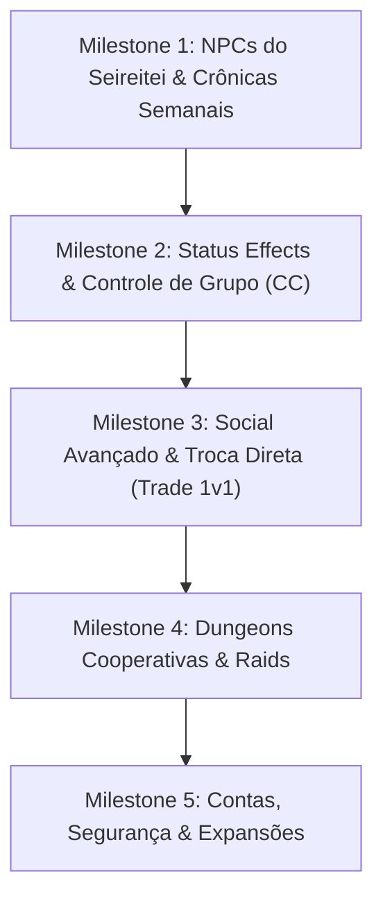

# Roadmap do Projeto Bleach Idle

Este documento consolida o planejamento estratégico e técnico do **Bleach Idle**, dividindo o progresso entre o que já foi entregue, as prioridades imediatas e as futuras expansões.

---

## Estado Atual do Jogo (O que já está implementado)

- **8 Personagens Jogáveis:** Ichigo, Rukia, Renji, Ishida, Sado, Hitsugaya, Byakuya e Kenpachi.
- **Evolução Fiel à Lore:** Cada personagem possui **5 estágios** (níveis 1, 10, 30, 60 e 100), com sprites, técnicas que evoluem e gritos característicos.
- **Sistema de 4 Técnicas:** Mapeadas em teclas dedicadas (1, 4, 5, 6), aprendidas progressivamente com dano em área (`area`).
- **Mundo e Mapas:** Karakura, Soul Society (Seireitei + Rukongai), Hueco Mundo, Las Noches, Karakura Falsa (60+), Wandenreich (95+) e Dangai (desafio sem fim).
- **Progressão de Longo Prazo:** Renascimento (rebirths com bônus permanente de dano/vida/XP), Marcos de Nível (Caixas do Kisuke), Bestiário em 3 estágios, 19 Conquistas, Missões Diárias e Recompensa Diária (ciclo de 7 dias).
- **Economia e Equipamentos:** 29 itens, 7 slots de equipamento, conjuntos com bônus de sinergia, Forja do Kisuke até +10, Loja de Cristais cosméticos (auras, títulos, borboletas, crônicas) e Mercado entre jogadores com expiração de 7 dias.
- **Automação Completa:** Auto Helper (Target, Hunt, Heal, Treino, Auto Venda), caçada offline contínua de até 12 horas e sobrevivência a quedas/reinícios de servidor.
- **Temporadas e Eventos:** Passe de temporada mensal gratuito (30 níveis), Chefe Mundial periódico (Menos Ancião a cada 2h), Invasões de Hollows (a cada 3h) e Fim de Semana com XP dobrado.
- **Ferramental & Qualidade:** Modo DEV para testes rápidos, Modo HD com sprites de alta resolução e suíte de 76 testes automatizados (Vitest) integrados com GitHub Actions CI.

---

## Próximos Marcos de Desenvolvimento

---

### Milestone 1: NPCs do Seireitei & Crônicas Semanais da Lore (Foco Atual) 🎯
Transformar a Soul Society (Seireitei) em um centro vibrante de história e narrativa, onde NPCs representam momentos marcantes da obra e trazem eventos semanais rotativos.

1. **Arquitetura de NPCs Interativos:**
   - Generalizar a camada de objetos de mapa (`logica`) para suportar instâncias de NPCs interativos (`npc` com id, sprite, nome e diálogo).
   - Diálogo com opções de resposta, árvore de conversa e entrega de tarefas ou lore.
2. **Sistema de Crônicas Semanais (Eventos da História de Bleach):**
   - A cada semana do calendário real, um evento da história é ativado no servidor, por exemplo:
     - **Semana da Invasão do Ryoka:** Ichigo e amigos invadem o Seireitei; missões de escolta, duelos contra tenentes e desafios no muro de Shakonmaku.
     - **Semana da Traição no Soukyoku:** Aizen revela seu plano e confronta o Gotei 13; evento mundial ou instância temática da colina do Soukyoku.
     - **Semana do Passado (Turn Back the Pendulum):** Evento histórico com visual e tarefas envolvendo os Vizard e Urahara capitão.
     - **Semana do Inverno das Espadas:** Batalha contra Arrancars e Privaron.
     - **Semana da Guerra dos Mil Anos (Wandenreich Invasion):** Queda da Soul Society sob invasão dos Quincy.
3. **Recompensas Temáticas:**
   - Títulos exclusivos temporários ou permanentes, cristais da conta, fragmentos de memórias e cosméticos temáticos.

---

### Milestone 2: Status Effects & Controle de Grupo (CC) no Combate
Enriquecer a tática das técnicas adicionando efeitos de estado ao combate de jogadores e monstros:

1. **Congelamento / Imobilização (Freeze):**
   - Habilidades da Rukia (*Tsugi no Mai: Hakuren*, *Hakka no Togame*) e Hitsugaya imobilizam o alvo por tempo determinado, impedindo movimento e golpes normais.
2. **Lentidão (Slow):**
   - Redução temporária na taxa de passos (`stepMs`) do alvo.
3. **Sangramento / Queimadura (DoT - Damage over Time):**
   - Dano periódico a cada tick de servidor (ideal para técnicas de corte pesado de Kenpachi ou chamas de capitães).
4. **Atordoamento (Stun):**
   - Interrupção de conjuração e cancelamento temporário de ações.
5. **UI & Efeitos Visuais:**
   - Tints no sprite (azul claro para congelado, vermelho para queimadura), números de dano de DoT em cor distinta e ícone de status na barra de vida.

---

### Milestone 3: Social Avançado, Troca Direta e Guildas
Aprofundar a interação entre jogadores em tempo real:

1. **Troca Direta (Trade 1v1):**
   - Solicitação de troca segura entre jogadores no mesmo mapa e alcance (`INTERACT_RANGE`).
   - Janela com duas etapas de confirmação (oferta de itens + kan e confirmação final com trava).
2. **Abas de Chat no Cliente:**
   - Divisão do chat em abas dedicadas: `Geral`, `Combate/Log`, `Party`, `Guilda` e `Privado (PM)`.
3. **Filtro de Loot Customizável no Auto Helper:**
   - Painel para o jogador selecionar o que recolher, ignorar ou converter direto em kan via Auto Venda.
4. **Banco e Sede de Guilda:**
   - Depósito de itens e kan compartilhado para membros da guilda, com permissões configuráveis pelo líder.

---

### Milestone 4: Dungeons Cooperativas & Raids de Party
Conteúdo PvE instanciado que exige trabalho em equipe:

1. **Salas Instanciadas de Desafio:**
   - Entradas no Seireitei ou Hueco Mundo que criam uma sala Colyseus temporária para a party.
   - Puzzles de alavancas, ondas cronometradas e chefes com mecânicas de fases (ex.: troca de vulnerabilidade ou escudo de reishi).
2. **Defesa do Portal Senkaimon:**
   - Modo de sobrevivência em grupo contra hordas que tentam invadir Karakura.

---

### Milestone 5: Infraestrutura, Contas e Segurança
1. **Recuperação de Contas:**
   - Cadastro de e-mail opcional com fluxo de redefinição de senha segura via token assinado.
2. **Rate Limiting Persistente:**
   - Mover tentativas de login de memória do processo para SQLite/Redis caso haja expansão para múltiplos workers.
3. **Testes End-to-End no Navegador:**
   - Suíte Playwright automatizada para validação visual, fluxo de login, criação de personagem e combate em browsers reais.
