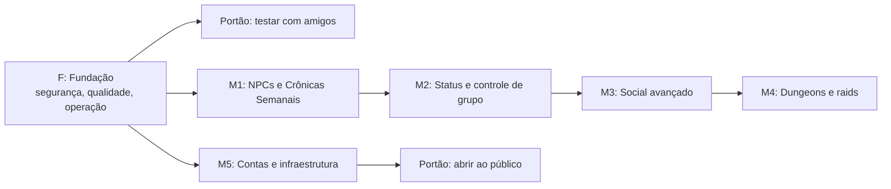

# Roadmap do Bleach Idle

Fonte única do que existe, do que vem a seguir e em que ordem. Se algo não está aqui, não está planejado. Quem conclui um item atualiza este arquivo no mesmo PR.

Atualizado em 31/10/2026.

## Como usar (para quem chega agora)

1. Leia o [README](../README.md) (o jogo), o [AGENTS.md](../AGENTS.md) (regras de engenharia) e este arquivo.
2. Escolha um item com status **Pronto**: todas as dependências dele estão **Feito**.
3. O ID do item (`F-04`, `M1-03`) vai no nome da branch (`feat/m1-03-dialogo-npc`) e no título do PR.
4. Siga o [fluxo de trabalho](#fluxo-de-trabalho) e confira a [definição de pronto](#definição-de-pronto).
5. Item **Precisa de spec** não começa sem PRD e ADR aprovados. O modelo está em [`features/cronicas-semanais-lore/`](features/cronicas-semanais-lore/PRD-cronicas-semanais-seireitei.md).

Status: `Feito` · `Em andamento (quem)` · `Pronto` · `Bloqueado por X` · `Precisa de spec` · `Decisão pendente (quem decide)`.
Tamanho: **P** cabe num PR pequeno; **M** exige alguns PRs ou mexe em cliente e servidor; **G** precisa ser fatiado antes de começar.

Onde fica cada informação: este arquivo guarda ID, ordem, dependência e status. O detalhe de cada débito fica em [`pendencias.md`](pendencias.md), as lições em [`aprendizados.md`](aprendizados.md), as medições em [`baseline.md`](baseline.md) e a especificação de cada funcionalidade grande em `docs/features/<nome>/`.

## Estado atual

- **8 personagens jogáveis:** Ichigo, Rukia, Renji, Ishida, Sado, Hitsugaya, Byakuya e Kenpachi, cada um com 5 estágios da obra (níveis 1, 10, 30, 60 e 100) e 4 técnicas nas teclas 1, 4, 5 e 6.
- **7 mapas:** Karakura, Soul Society (Seireitei e Rukongai), Hueco Mundo, Las Noches, Karakura Falsa (60+), Wandenreich (95+) e Dangai (desafio sem fim).
- **Progressão de longo prazo:** renascimento com bônus permanente, marcos de nível, bestiário em 3 estágios, 21 conquistas, 23 missões do Kisuke, missões diárias e recompensa diária de 7 dias.
- **Economia:** 45 itens (26 de equipamento), 7 espaços de equipamento, conjuntos com bônus, forja até +10, 32 cosméticos na Loja de Cristais e mercado entre jogadores com anúncios de 7 dias.
- **Automação:** Auto Helper (alvo, caçada, cura, treino, venda), caçada offline de até 12 horas que sobrevive a reinício do servidor.
- **Eventos:** passe de temporada mensal grátis, chefe mundial a cada 2 h, invasões de Hollows a cada 3 h e XP em dobro aos sábados e domingos (Brasília).
- **Qualidade:** 76 testes Vitest e 31 cenários de integração no CI, cinco skills de projeto e uma [linha de base medida](baseline.md).

## Ordem de execução

A ordem é de prioridade, não de dependência técnica, salvo onde a coluna "Depende de" disser o contrário. Os marcos de M2 em diante só ganham itens fatiados quando virarem o foco.

## Fluxo de trabalho

1. **Escolha** um item `Pronto` e marque `Em andamento (seu nome)` aqui, no mesmo PR ou num commit pequeno.
2. **Branch** a partir da `main` atualizada: `feat/`, `fix/`, `test/`, `docs/` ou `chore/` + ID + assunto.
3. **Implemente em passos pequenos**, com teste (skill `testes-deterministicos`) e a skill do assunto (`seguranca-servidor`, `adicionar-conteudo`, `performance-servidor`).
4. **Verifique localmente:** `npm run typecheck`, `npm test`, os cenários afetados e `gitleaks git --redact -c .gitleaks.toml .`.
5. **Revisão adversarial antes de publicar.** Quem escreveu o código não o revisa: outra pessoa, ou uma sessão nova de agente com a skill `revisar-pr`. O revisor procura o que está errado em vez de confirmar o que parece certo, e confere cada afirmação contra o código. Achado BLOQUEIA ou ALTA é corrigido antes do passo seguinte.
6. **Commit e push** só depois do passo 5, em commits pequenos de um assunto só.
7. **Abra o PR** com o modelo do repositório (`.github/pull_request_template.md`) e cole o veredito da revisão.
8. **CI verde.** Se estiver vermelho, ache a causa (`gh run view ID --log-failed`) e corrija em commit separado, mesmo que a falha já existisse.
9. **Merge** por uma pessoa, ou por agente com pedido explícito, com CI verde e sem achado BLOQUEIA ou ALTA aberto. PR com commits bem separados entra por "rebase and merge"; PR com commits de trabalho, por "squash".
10. **Feche o item:** status `Feito` aqui, lição em `aprendizados.md`, sobras em `pendencias.md`.

## Definição de pronto

- O comportamento novo tem teste que falha sem a mudança (`npm test` e, se mexe no servidor, o cenário correspondente).
- `npm run typecheck`, `npm test` e o CI estão verdes.
- Toda entrada vinda do cliente é validada no servidor.
- Save antigo continua carregando (campo novo tem padrão em `fromSave`).
- Conteúdo novo passa em `verificar-catalogo.mts` e, se mexeu em mapa, em `mapcheck.ts`.
- Documentos atualizados: este roadmap e, quando couber, `aprendizados.md` e `pendencias.md`.
- Revisão adversarial feita e registrada no PR.

## Portões

| Portão | Condição |
| :--- | :--- |
| Testar com amigos | F-01, F-02 e F-03 `Feito`, e o deploy do [DEPLOY.md](../DEPLOY.md) |
| Abrir ao público | O anterior, mais F-04 a F-07 e F-13, M5-01 (recuperação de senha), M3-05 (moderação de chat), balanceamento dos mapas avançados e a lista "Antes de abrir para o público" do DEPLOY.md |

## F: Fundação (segurança, qualidade e operação)

Vem antes de abrir o jogo a mais gente e antes de construir em cima de M1. Evidências nas seções 7 a 9 de [`pendencias.md`](pendencias.md).

| ID | Entrega | Tam. | Depende de | Status | Ref. |
| :-- | :--- | :-- | :--- | :--- | :-- |
| F-01 | Modo Dev só liga com `BI_DEV=1` | P | | Em andamento (PR de segurança) | S1 |
| F-02 | Chave vinda do cliente não indexa objeto comum (`Object.hasOwn`) | P | | Em andamento (PR de segurança) | S2 |
| F-03 | Limite de login por IP usa o IP real atrás do Caddy | P | | Em andamento (PR de segurança) | S3 |
| F-04 | Capturar só `UNIQUE` em `createAccount` e `createChar` | P | | Pronto | S6 |
| F-05 | Contêiner roda como `node`, não como root (conferir a permissão do volume `/data`) | P | | Pronto | S9 |
| F-06 | CSP e cabeçalhos de segurança no Caddy | P | | Pronto | S7 |
| F-07 | Proteger a `main`: PR obrigatório e CI verde | P | | Decisão pendente (dono do repositório) | S8 |
| F-08 | Métrica da duração do tick, com aviso acima de 50 ms | P | | Pronto | P3 |
| F-09 | Ranking sem bloquear o tick | M | F-08 | Bloqueado por F-08 | P1 |
| F-10 | Trocar `sleep` fixo por `vi.waitFor` ou `once`; limpar o ruído do Vitest | M | | Pronto (contínuo) | Q2, Q3 |
| F-11 | Subir `actions/checkout` e `actions/setup-node` para a v7 | P | | Pronto | Q5 |
| F-12 | Upgrade maior do Colyseus (0.15 para 0.18) | G | spec | Precisa de spec | S5 |
| F-13 | Primeiro deploy com HTTPS atrás do Caddy e restauração de backup testada | M | | Decisão pendente (servidor e domínio) | DEPLOY.md |

Recomendação: fazer F-12 antes de M4, porque as salas instanciadas dependem do Colyseus e é melhor não construir sobre uma versão com advisory.

## M1: NPCs do Seireitei e Crônicas Semanais (foco atual)

Especificação: [PRD](features/cronicas-semanais-lore/PRD-cronicas-semanais-seireitei.md), [ADR-001](features/cronicas-semanais-lore/adrs/ADR-001-arquitetura-npcs-interativos.md) (NPCs), [ADR-002](features/cronicas-semanais-lore/adrs/ADR-002-rotacao-semanal-cronicas.md) (rotação semanal) e [ADR-003](features/cronicas-semanais-lore/adrs/ADR-003-protocolo-rede-e-interface-dialogo.md) (rede e diálogo). Fatiamento proposto em passos do tamanho de um PR:

| ID | Entrega | Tam. | Depende de | Status |
| :-- | :--- | :-- | :--- | :--- |
| M1-00 | Fechar os pontos em aberto do [PRD §8](features/cronicas-semanais-lore/PRD-cronicas-semanais-seireitei.md#8-pontos-em-aberto-conferidos-contra-o-código-31102026) (itens que faltam, NPC de cada semana, título temporário) | P | | Decisão pendente (Waldir e Rafael) |
| M1-01 | `shared/src/chronicles.ts` (`weekNumber`, `weekIndex`, `currentWeekKey`) com testes em vários fusos | P | | Pronto |
| M1-02 | `shared/src/npcs.ts`: tipos e catálogo de NPCs | P | | Pronto |
| M1-03 | NPCs no `soul.tmj` (objeto `npc` na camada `logica`), leitura em `parseMap` e `mapcheck` | M | M1-02 | Bloqueado por M1-02 |
| M1-04 | Servidor: `interact` com `kind: "npc"`, `npc_dialog` e `npc_action`, com a distância validada | M | M1-02, M1-03 | Bloqueado |
| M1-05 | Persistência: `Progress.chronicle` com padrão em `fromSave` | P | M1-01 | Bloqueado por M1-01 |
| M1-06 | Missão semanal e recompensa uma vez por semana, por personagem (D-001) | M | M1-00, M1-04, M1-05 | Bloqueado |
| M1-07 | Cliente: janela de diálogo no `#modal` (teclado, toque e `Esc`) | M | M1-04 | Bloqueado por M1-04 |
| M1-08 | Textos e conteúdo das 5 crônicas | M | M1-00 | Bloqueado por M1-00 |
| M1-09 | Cenário `cronicas.ts` e testes de rotação, diálogo e entrega | M | M1-06, M1-07 | Bloqueado |

## M2: Status e controle de grupo no combate

Todos `Precisa de spec` (PRD e ADR primeiro). Itens: **M2-01** motor de status no servidor (expiração por tick); **M2-02** congelamento (Rukia e Hitsugaya); **M2-03** lentidão (reduz `stepMs`); **M2-04** dano ao longo do tempo (Kenpachi e chamas de capitães); **M2-05** atordoamento (interrompe conjuração); **M2-06** efeitos visuais (cor no sprite, ícone de status, número de dano contínuo); **M2-07** tempo de recarga numérico no HUD.

## M3: Social avançado

Todos `Precisa de spec`. **M3-01** troca direta 1 contra 1, em duas confirmações, no mesmo mapa e alcance; **M3-02** abas de chat (Geral, Combate, Party, Guilda, Privado); **M3-03** filtro de loot do Auto Helper; **M3-04** banco de guilda com permissões por cargo; **M3-05** moderação de chat (filtro de spam, silenciar, comandos de GM).

## M4: Dungeons cooperativas e raids

Todos `Precisa de spec`, e depois de F-12. **M4-01** salas instanciadas para a party; **M4-02** puzzles, ondas cronometradas e chefes com fases; **M4-03** defesa do portal Senkaimon (sobrevivência em grupo).

## M5: Contas e infraestrutura

Todos `Precisa de spec`. **M5-01** recuperação de senha por e-mail com token assinado; **M5-02** limite de tentativas persistente (SQLite ou Redis, se houver mais de um processo); **M5-03** testes de ponta a ponta no navegador com Playwright; **M5-04** partição do mundo por mapa para centenas de jogadores (hoje um processo só; limites medidos em [`baseline.md`](baseline.md)).

## Sem marco

Visual de equipamentos além do haori e da máscara, e interiores de edifícios ([`pendencias.md`](pendencias.md) §2 e §5). Entram num marco quando alguém propuser a spec.

## Decisões tomadas

| ID | Data | Decisão | Quem |
| :-- | :--- | :--- | :--- |
| D-001 | 31/10/2026 | A trava das recompensas em cristais fica **por personagem** (comportamento atual). Cada personagem extra repete a diária e as conquistas, até 5 por conta. Recompensa nova (como as Crônicas) segue a mesma regra, e o balanceamento deve contar com isso. | Waldir; Rafael confirma na revisão do PR #2 |
| D-002 | 31/10/2026 | Nada é publicado sem revisão adversarial, e PR só é mesclado com CI verde (fluxo de trabalho, passos 5 a 9). | Waldir |
| D-003 | 31/10/2026 | Skills do projeto ficam em `.claude/skills/`, com um link por skill em `.kiro/skills/`. | Waldir |

## Riscos

- **Colyseus 0.15 com advisory** (S5): o upgrade é grande. Fazer com testes mais fortes (F-10) e em PR próprio.
- **`WorldRoom.ts` com mais de 2.500 linhas:** código novo entra em `registerXMessages` próprio ou em módulo novo; refatorar só com teste cobrindo o trecho.
- **Um processo só:** a simulação, os saves e o ranking dividem o mesmo ciclo de 100 ms. Medir antes de crescer (F-08).
- **Direitos autorais:** Bleach pertence à Shueisha. O projeto é de fã e sem monetização; com monetização, espere pedidos de remoção (DEPLOY.md).
